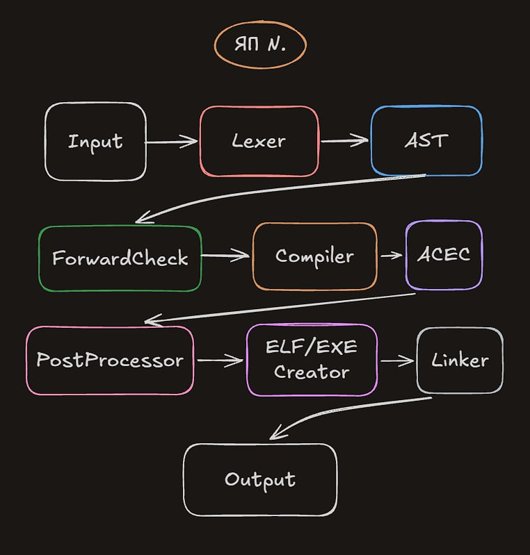

# N - Язык Программирования

Придуман в 2026 году разработчиком ntcd_lol на базе сборных концептов с C++, Zig, Rust и других низкоуровневых языков.

Содержание:
1. Риторика
   - Смысл и суть
   - UOOP, ForwardCheck, ACEC и PostProcess
2. База
   - `nbindapi`
   - Функции компилятора
   - `nlib` и `bscnlib`
   - Схема работы
3. Код
   - Функции
   - Классы
   - Объекты
   - Неймспейсы
   - Формы
   - Срезы контекста
   - Операции
   - Операторы
4. Компилятор
   - Вид
   - Флаги
   - Ошибки

## Риторика

### Смысл и суть

N разрабатывался как гибкий язык программирования, нацеленный как и на работу с высокоуровневыми вещами, так и на низкоуровневую работу.
Был придумал только из концепции того, что другие языки программирования непригодны для определенных средств, а все вместе держать для разработки - неудобно.
Так же был придуман с целью сделать язык программирования удобно меняемый под определенного человека, засчет чего человек может запросто преопределить логику базового оператора.

### UOOP, ForwardCheck, ACEC и PostProcess

**UOOP** *(Unstable Object-Oriented Programming, по русски: Нестабильное Объектно-Ореинтированное Програмиирование)* - Собственный стиль программирования N, благодаря которому можно отделять строгость языка, от удобности. Stable Class представляет собой обычный ООП класс (C++-style), но что более оптимизирован засчет другой концепции хранения объектов в ОЗУ, и точно так же строг. Unstable Class - является уже нестабильным ООП классом по типам и видам возратности (Python-style), тоесть если число в `private` было `int`, его легко переделать в `float` или `double`, от чего может начаться путаница, но для новичков это может оказаться более удобным вариантом, и не только для них, в некоторых ситуациях и в тяжелых проектах может понадобится нестабильный объект. Одно из преимуществ - малая цена преобразований, засчет определения всех возможных типов одной переменной или объекта, и создание аналогов в зависимости от размеров и slow/fast режимов.

**ForwardCheck** *(по русски: Проверка Наперед)* - Этап перед компиляцией, что проверяет код на теоретические ошибки. Может заранее предугадать обращение к пустой памяти, или то, что сможет выйти из под правил. Так же решает неприятную проблему - компилятор молчит и компилирует код, и сломается посреди компиляции, или при запуске программа вообще может отказаться работать.

**ACEC** *(After-Compile Error Checker, по русски: Проверка Ошибок После Компиляции)* - Этап после компиляции, что помогает определить возможные ошибки и проблемы после этапа компилирования. Анализирует ASM код, сопоставляя все инструкции и возможные паттерны, и простейшую симуляцию процессора.

**PostProcess** *(по русски: Пост-Тест)* - Этап после ACEC, что оптимизирует итоговый код, при уровнях оптимзации выше 4-го, или при его включении определеным флагом.

## База

### `nbindapi`

`nbindapi` представляет собой API на C++, спроектированный под изменения N со стороны за ним. C помощью данного API можно менять функции компилятора, создавать keywords и новую логику как плагины, а не полноценную смену внутреннего кода.

### Функции компилятора

N отличается тем, что использует вместо препроцессинга - функции компилятора. Их можно создавать самостаятельно, используя `nbindapi`, и они обрабатываются компилятором и сам их возврат вставляется в ту же точку внутрь кода. Их множество:

```n
/-
 - Использование
 -/
 
@...(...);
// или
@... ... = ...;
// @ - Символ с которого начинается использование функции компилятора.

/-
 - Работа с файлами на N.
 -/
@add("path/to/file");
// Добавление стороннего файла N, учитывает внутренние пресеты и вид. вставляет значение по разному, в зависимости от вида использования.

@del("path/to/file");
// или
@del(object);
// Удаление стороннего файла N, если файл вставлялся напрямую (небезопасный, менее оптимизированный метод) - надо указывать path, иначе при использовании инициализации как авто-константа - стоит указывать объект.

/-
 - Define и Use
 -/

@def key: type = value;
// Работает как define в С/C++, но умнее засчет учитывания контекста и методов использования. type необязателен, но желателен.

@use(namespace_or_object);
// или
@use(namespace_or_object) {
   // твой код
};
// Использование конкретного контекста класса или объекта.

/-
 - Пресеты
 -/ 

@preset("path/to/preset");
// Используется в целях объявления файла конкретного вида, к примеру для include-подобных файлов лучше всего использовать пресет add - специализирован под добалвения в файлы. Хоть и не обязательно, но гарантирует безопасность.

/-
 - Replace-All Вариации
 -/

@!...(...);
// или
@!... ... = ...;
// ! в начале функции говорит вызвать ее критический вариант, что обычно является Replace-All.

@!del(...);
// !del удаляет файл не только из этого файла, но и из всего бинарника полностью

@!def ... = ...;
// !def заменяет абсолютно все def этой переменной что были ранее и ставит на месте себя обычный def
```

### `nllib` и `bscnlib`

`nlib` *(N Library)* - Встроенная базовая библеотека N, что в свою очередь имеет объавление базовых операторов, логики, встроенных функций компилятора и некоторых keyword.

`bscnlib` *(Basic N Library)* - Базовая библеотека для разработчика на языке программирования N, содержит в себе:

```text
io      - I/O (Ввод/Вывод, с методами send/buffer/stream)
math    - Math (базовые операции с хорошей оптимизацией)
hmath   - High/Hard Math (ML, Комплексные числа, Вероятности и т.д.)
async   - Async (Асинхронность)
proc    - Processes (Мульти-Процессинг)
thread  - Threads (Потоки)
fs      - File System (Работа с файловой системой)
mem     - Memory (Работа с ОЗУ)
bits    - Bits (Работа с данными непривычных размеров или видов)
bdata   - Big Data (Быстрая обработка большой информации)
str     - Strings (Работа со строками)
winapi  - Обертка Windows API, DirectX, NT API
macapi  - Обертка Cocoa, AppKit, Metal
lxapi   - Обертка Syscalls, Linux Kernel API, D-Bus API
```

### Схема Работы

<table width="100%">
  <thead>
    <tr>
      <th width="40%">Фото</th>
      <th width="60%">Псевдо-код</th>
    </tr>
  </thead>
  <tbody>
    <tr>
      <td align="center">
        
      </td>
      <td>
          <pre style="background: #161b22; color: #e6edf3; padding: 16px; border-radius: 6px; font-family: ui-monospace, SFMono-Regular, SF Mono, Menlo, Consolas, Liberation Mono, monospace; font-size: 13px; line-height: 1.45; overflow: auto; border: 1px solid #30363d; margin: 0;">function compileLanguageN(sourceCode):
      inputData = Input(sourceCode)
      tokens = Lexer(inputData)
      ast = AST(tokens)
      checkedAST = ForwardCheck(ast)
      intermediateCode = Compiler(checkedAST)
      acecCode = ACEC(intermediateCode)
      processedCode = PostProcessor(acecCode)
      binaryObject = ELF_EXE_Creator(processedCode)
      executable = Linker(binaryObject)
      return Output(executable)</pre>
      </td>
    </tr>
  </tbody>
</table>

## Код

На самом деле, код на N выглядит как смешение C++, Rust, Zig и Python, но бояться сильно не стоит, так как он остается читаемым.

### Функции

Функции в N определяются достаточно простым методом:

```n
dot foo() -> sout {};
```

Сейчас детально разберем.

| Токен | Объяснение |
|-------|------------|
| `dot` | Является Keyword создания функции, риторика в том что сам ASM использует создание функций в виде `.lol:` - где `.` = `dot` в нашем случае. |
| `foo` | Само имя переменной, может даже включать в себя Unicode нативно (многовероятно преобразование в вид ASCII). |
| `()`  | Список аргументов. Тут он пуст, но это не обозначает что нельзя ничего передать. |
| `->` | Обозначает инициализацию конечного типа заранее, так же можно указать хоть итоговое выражение или переменную. **ВАЖНО:** `->` легко заменяемо на `:` - это тоже верное выражение, но для удобного прочтения оно не советуется. |
|`sout` | Тип в N, что расшифровывается как `Standard Out` - тоесть обычный выход из функции/программы. Просто 0.
|  `{}` | Тело функции. В данном случае оно пустое.|
